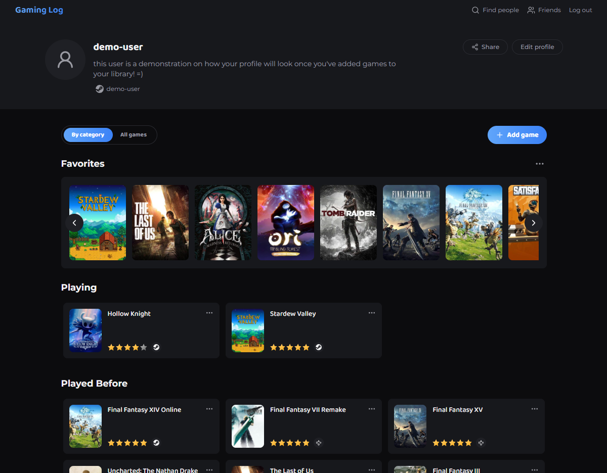
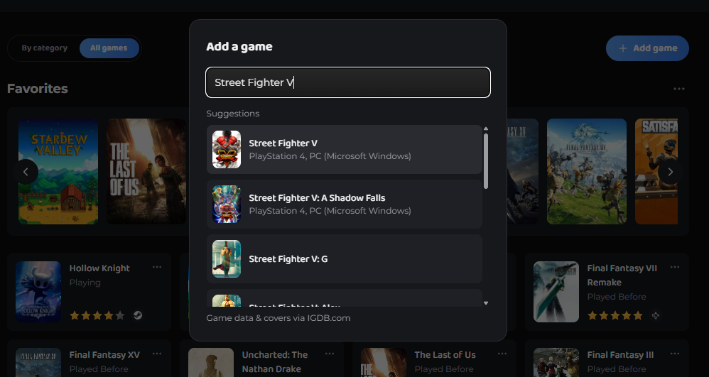

# Gaming Log

A web app to catalog the games you play — what you're playing now, what you've
played, what you want to play next, and the favorites you want to show off —
and share that profile with friends.

**Live:** https://gaming-log-app.vercel.app/

**Demo profile (no login needed):** https://gaming-log-app.vercel.app/u/demo-user




Built with: React 19, TypeScript, Vite, Tailwind CSS 4, Node.js, Express 5, Prisma, PostgreSQL (Neon), IGDB API, Vercel.

## Features

**Your library**
- Organize games into three categories: **Playing**, **Played Before** and
  **Want to Play**.
- Mark any game as a **Favorite** — it shows up in a showcase row at the top
  of your profile without leaving its category.
- Rate games with 1–5 stars and record the platform you play on (PC, Steam,
  PlayStation, Xbox, Switch, Other).
- Drag and drop to move games between categories and to reorder games inside
  a category or in the Favorites row (mouse, touch and keyboard).
- Switch between a **By category** view and an **All games** grid.
- Edit or remove any game from its card menu.

**Shared game catalog**
- Every game lives in one catalog shared by all users: once someone adds a
  title, everyone can find it.
- When a game isn't in the catalog yet, the add-game flow suggests title,
  genre and cover from [IGDB](https://www.igdb.com/). The user reviews the
  suggestion before it's saved.
- Covers can come from an IGDB suggestion, a pasted URL, or an uploaded image.

**Profile**
- Avatar upload, a 280-character bio (emoji welcome) and social links (Steam,
  Xbox, PlayStation, Nintendo, Discord, Epic, Battle.net, Twitch…) that can be
  reordered.
- Change username or password, or delete the account.

**Social**
- Shareable profile link at `/u/<username>`.
- Three visibility levels: **Public** (anyone, even without an account),
  **Friends only** (the default) and **Private** (only you). Visibility is
  enforced on the server: a restricted profile's response never contains the
  hidden data.
- Find people by username and send friend requests. Friends are mutual
  (request → accept), managed from a friends panel with a pending-requests
  badge.

## Tech stack

| Layer | Tools |
|---|---|
| Frontend | React 19, TypeScript, Vite, React Router, Tailwind CSS 4, dnd-kit, Radix UI, lucide-react, simple-icons |
| Backend | Node.js, Express 5, TypeScript, Zod, JWT in an httpOnly cookie, bcrypt |
| Database | PostgreSQL (Neon via Vercel) with Prisma |
| Storage | Vercel Blob (avatars and uploaded covers) |
| External data | IGDB API (via Twitch OAuth) |
| Hosting | Vercel (static site + one serverless function for `/api`) |

## Project structure

```
client/   React SPA (Vite), deployed as the static site
server/   Express API, Prisma schema, migrations and seed script
shared/   Types shared by client and server (API request/response shapes)
api/      index.ts re-exports the Express app as the Vercel serverless function
```

`api/index.ts` sits at the repo root because Vercel only detects functions in
a root-level `api/` folder. `vercel.json` rewrites `/api/*` to it and sends
every other path to `index.html`, so links like `/u/<username>` work on a
hard refresh.

## Running locally

Requirements: Node.js 20+ and a PostgreSQL database (a free Neon database
works).

1. Install all three workspaces from the repo root:
   ```bash
   npm install
   ```
2. Copy `server/.env.example` to `server/.env` and fill in the values (see
   the table below).
3. Create the tables and, optionally, add sample data:
   ```bash
   cd server
   npx prisma migrate dev
   npx prisma db seed   # 6 sample games + a "demo" user (password printed to the console)
   cd ..
   ```
4. Start everything:
   ```bash
   npm run dev
   ```
   This runs the client on http://localhost:5173 and the API on
   http://localhost:3001. Vite proxies `/api/*` to the API.

## Environment variables

All live in `server/.env` locally and in the Vercel project settings in
production.

| Variable | Description |
|---|---|
| `DATABASE_URL` | **Pooled** Postgres connection string (hostname contains `-pooler`). Used by the app at runtime; the direct string would exhaust connections under serverless traffic. |
| `DIRECT_URL` | Direct (non-pooled) connection string. Used only by `prisma migrate` / `prisma db seed`. |
| `JWT_SECRET` | Random 32+ byte value used to sign auth tokens. |
| `BLOB_STORE_ID` / `BLOB_READ_WRITE_TOKEN` | From the Vercel Blob store (project → Storage). |
| `IGDB_CLIENT_ID` / `IGDB_CLIENT_SECRET` | From a Twitch developer app at [dev.twitch.tv/console/apps](https://dev.twitch.tv/console/apps). Server-side only. Without them, IGDB suggestions are simply skipped. |
| `PORT` | Optional, local API port (default `3001`). |

## Scripts

| Command | What it does |
|---|---|
| `npm run dev` | Runs `shared` (watch), the client and the API together |
| `npm run build` | Builds `shared`, then `client`, then type-checks `server` |
| `npm run lint` | Lints `client` and `server` |

## Deploy

The repo is linked to Vercel: pushing to `main` builds and deploys
automatically. After a schema change, apply migrations to the production
database with `npx prisma migrate deploy` (run from `server/`, using the
production `DIRECT_URL`).

## Notes

- Seeded games have no cover on purpose; a placeholder tile is shown until a
  cover is added.
- Game data and covers suggested in the app come from IGDB.com, credited in
  the add-game flow.
